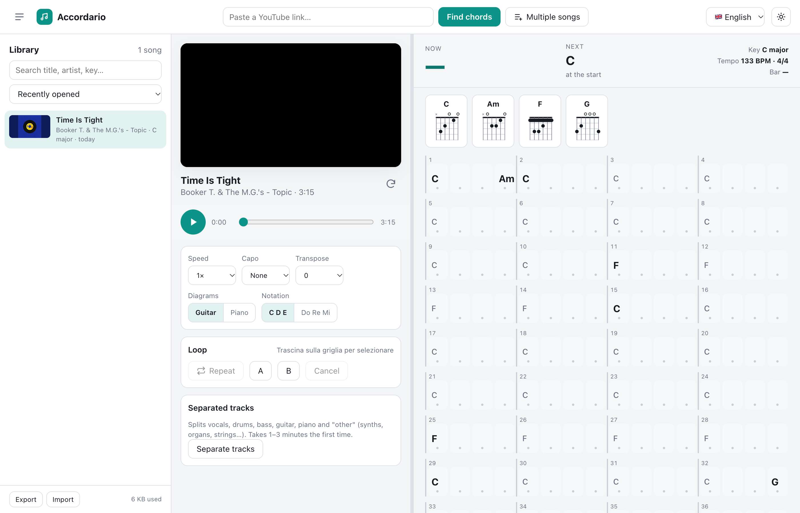

# Accordario

Find the chords of any song, running entirely on your own machine, with no
account and no login. Paste a YouTube link, and the server detects beats and
chords and shows them in a grid synced with the video.
It can also separate the tracks (vocals, drums, bass, guitar, piano, other)
so you can practice with just the keys, or play along on top.



## Getting started

```bash
./start.sh
```

Then open <http://127.0.0.1:8765>.

The first run creates the Python environment in `server/.venv` (about 850 MB,
because of PyTorch). Later runs start right away; `yt-dlp` is updated on every
start, because YouTube changes often.

Requirements: macOS/Linux, `ffmpeg` (`brew install ffmpeg`), Python 3.10–3.12,
Node.js (yt-dlp uses it to decode YouTube links).

## Usage

- **Click** a beat: the video plays from there.
- **Drag** across the grid (or `Shift`+click): select a section and loop it.
  The **A**/**B** buttons set the start/end at the current beat.
- **Right-click** a chord: fix it (applies until the next change).
  You can type either `F#m` or `Fa#m`.
- **Capo / Transpose**: capo changes the guitar shapes (ignored with piano
  diagrams), transpose changes the key.
- **Speed**: with the YouTube video you get 0.5×, 0.75×, 1×, 1.25×; with the
  separated tracks any speed, always without changing pitch.
- Shortcuts: `Space` play/pause, `←`/`→` previous/next bar, `L` loop,
  `Esc` clear selection, `-`/`+` speed.

### Queueing multiple songs

The **Multiple songs** button (or pasting several links in the top field)
opens a window where you paste a list of links, one per line, or a whole
playlist (up to 200 videos). The server downloads 3 songs at a time in
parallel and analyzes them one after another; finished songs show up in the
library with a **new** label. Meanwhile you can keep playing.

- The **Processing** section in the sidebar shows the status of each song;
  × removes it from the queue, ↻ retries the ones that failed.
- If you open a song that is still queued, it jumps ahead of the others.
- Check **Also separate tracks** to get songs ready with separated tracks too
  (about 2 extra minutes per song). It also works for songs already in the
  library: in that case it only does the separation.
- The queue is saved: if you close or reload the page it picks up where it
  left off. The work runs on the server, so it continues even with the page
  closed (as long as the server is running).

### Library

Analyzed songs are kept in the browser's `localStorage`, with chords,
corrections and settings (capo, loop, speed, track mix). From the sidebar you
can search them (title, artist, key), reopen them and delete them.
**Export/Import** saves or loads a JSON backup: useful because `localStorage`
is tied to the browser.

Deleting a song from the library also deletes the audio and tracks saved in
`server/cache/`.

### Separated tracks

The **Separate tracks** button uses Demucs (`htdemucs_6s`): about 2 minutes
for a 4-minute song on an Apple Silicon Mac, ~35 MB on disk per song.
Then turn on **Listen to separated tracks**: the video stays visible but muted,
and the audio comes from the tracks, which you can solo (S), mute (M) or adjust.

Handy presets for keyboard players:
- **Keys only** = Piano + Other
- **No keys** = everything except Piano and Other, to play along

Known limitation: no open model separates piano, synth and organ from each
other. Piano ends up in the *Piano* track; synths, organs and pads usually in
*Other* (together with strings and horns).

## How chord detection works

A Python server (FastAPI) with the neural networks from
[madmom](https://github.com/CPJKU/madmom):

1. `yt-dlp` downloads only the audio.
2. A recurrent network finds beats and downbeats (3/4 or 4/4).
3. A convolutional network + CRF computes, for every fraction of a second, the
   probability of each major/minor chord.
4. The probabilities are summed per beat and decoded with a beat-level
   Viterbi: chord changes prefer the downbeat of the bar, and chords in the
   detected key get a small advantage. This removes spurious one-beat chords.

The vocabulary is major/minor: sevenths
and other chords can be added by hand with right-click. Intros with only bass
or drums and heavily arranged passages are still the hardest cases.

A 4-minute song is analyzed in about 30 seconds. The result is saved in
`server/cache/<id>/analysis.json`, so reopening a song is instant.

## Project structure

```
start.sh              setup + start
server/app.py         API, job queue (parallel downloads, sequential analysis)
server/analysis.py    download, beats, chords, key
server/stems.py       track separation (Demucs)
web/index.html        interface
web/js/main.js        app logic
web/js/transport.js   single clock: YouTube player or track audio
web/js/grid.js        chord grid, selection, loop
web/js/chords.js      parsing, transposition, notation, fingerings
web/js/diagrams.js    guitar/piano SVG diagrams
web/js/library.js     localStorage library
web/js/queue.js       analysis queue (multiple songs / playlists)
```

## Notes

- If the owner doesn't allow embedding, the player is hidden and the
  downloaded audio plays instead, with a link to watch it on YouTube. Chords,
  loop, speed and tracks work as usual. The app remembers this (it detects it
  during analysis, or on the first player error) and doesn't even try to load
  the video next time.
- yt-dlp has deprecated Python 3.10. If it stops working one day, recreate
  the environment with Python 3.11 or 3.12: `rm -rf server/.venv && ./start.sh`.
- Live streams and videos longer than 30 minutes are not supported.
